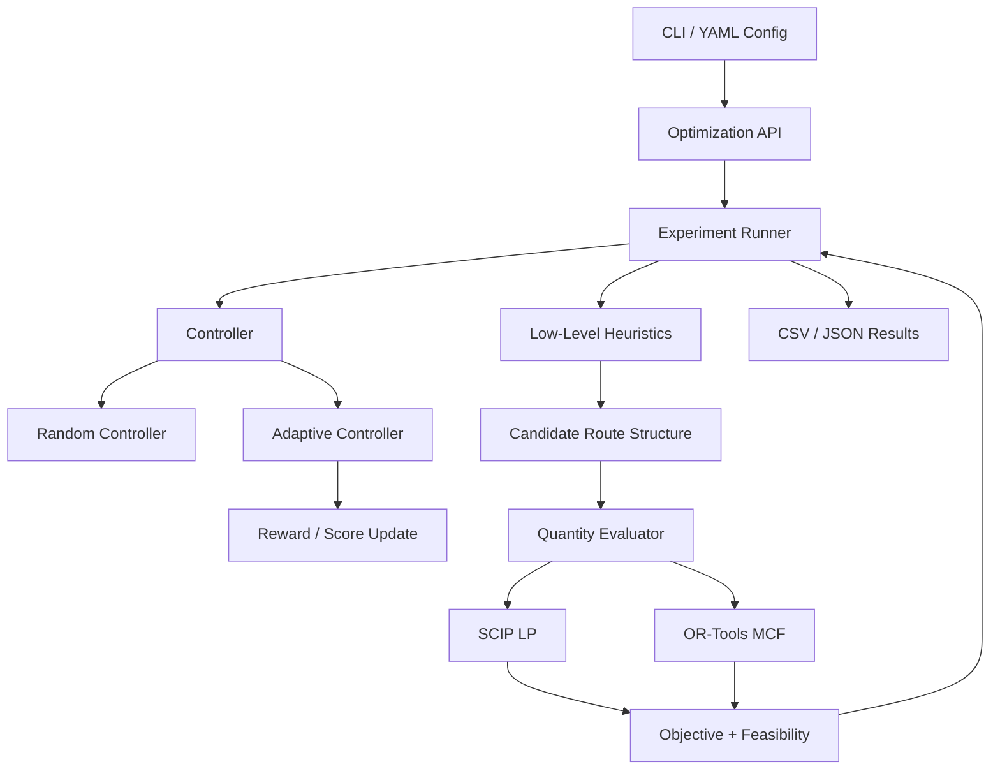

# Architecture

The project separates **experiment configuration**, **search control**, **problem-specific neighborhood operators**, and **continuous quantity reoptimization**.

## Design choices

### API layer

`api/service.py` exposes an application-level interface independent of the CLI. A notebook, test suite, web service, or batch job could call the same API later.

### Config layer

YAML files define experiment choices instead of hard-coding them. Search profile, solver, time limit, random seed, and instances can be changed independently.

### Controller layer

The controller decides **which operators to apply and in which sequence**. It does not need to know the implementation details of each heuristic.

### Heuristic layer

Every low-level heuristic follows a common interface. This keeps the search controller independent of the specific neighborhood portfolio.

### Solver layer

The route/visit structure is treated as fixed by the quantity solver. Two interchangeable implementations are provided:

- a general LP solved by SCIP,
- a specialized time-expanded minimum-cost-flow network solved by OR-Tools.

This separation enables direct ablation experiments without changing the search logic.
